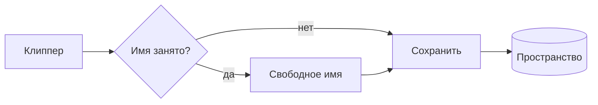
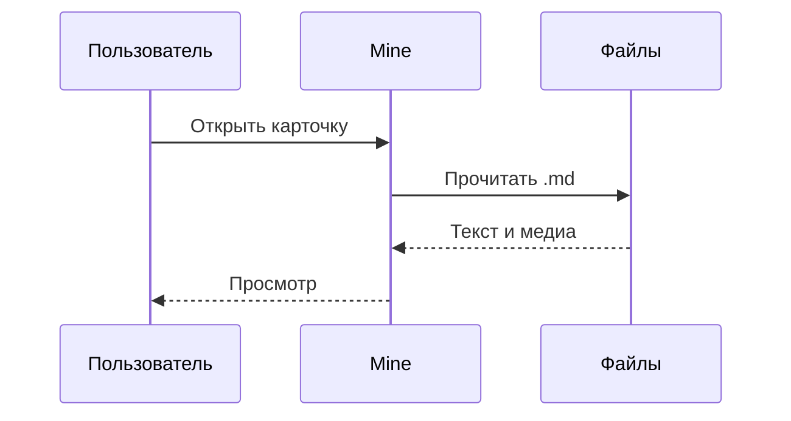
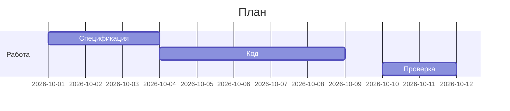
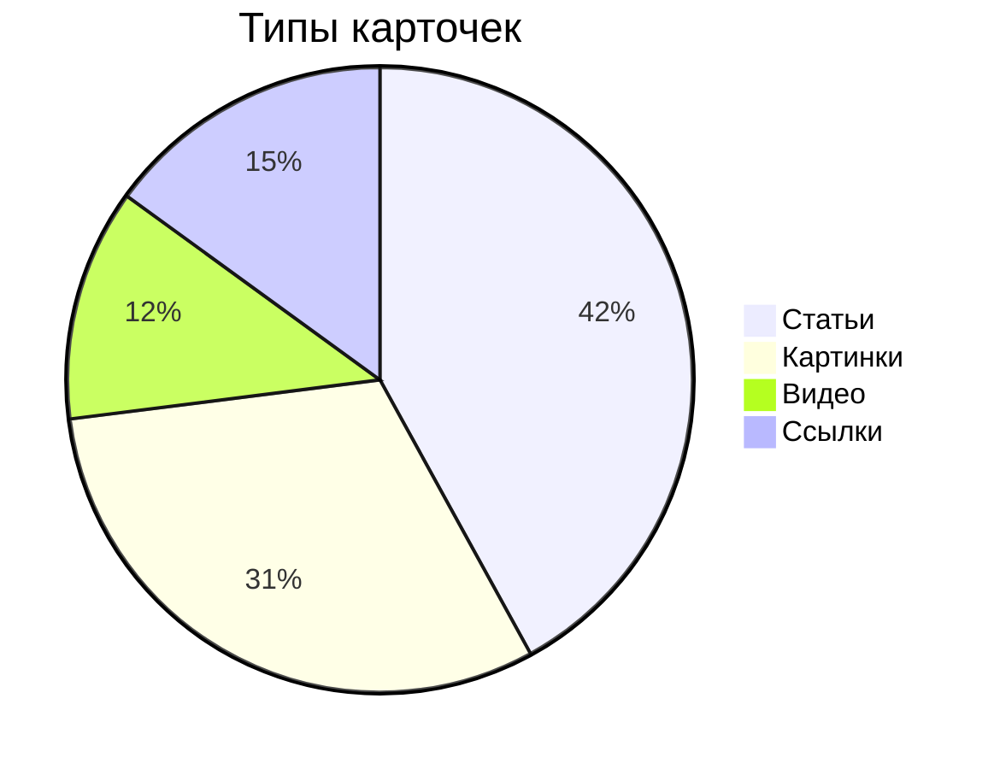
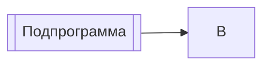

# Проверка просмотрщика: код, Mermaid, таблицы

Короткий абзац с **жирным**, *курсивом*, ***жирным курсивом***, ~~зачёркнутым~~, `встроенным кодом`, ==выделением== и [внешней ссылкой](https://example.com). Сноска в конце предложения.[^1] Ссылка на заметку [[Пример заметки]].

Очень длинный абзац для проверки переноса строк и ширины колонки чтения. Lorem ipsum dolor sit amet, consectetur adipiscing elit, sed do eiusmod tempor incididunt ut labore et dolore magna aliqua. Ut enim ad minim veniam, quis nostrud exercitation ullamco laboris nisi ut aliquip ex ea commodo consequat. Duis aute irure dolor in reprehenderit in voluptate velit esse cillum dolore eu fugiat nulla pariatur. Длинное слово без пробелов: Donaudampfschifffahrtselektrizitätenhauptbetriebswerkbauunterbeamtengesellschaft. Длинная ссылка без пробелов: https://example.com/a/very/long/path/that/never/breaks/naturally/and/keeps/going/to/test/overflow/in/the/reading/column?query=parameter&another=value

## Заголовок второго уровня

### Заголовок третьего уровня

#### Заголовок четвёртого уровня

##### Заголовок пятого уровня

###### Заголовок шестого уровня

## Списки

- Пункт маркированного списка
- Пункт со **вложенным** списком
  - Вложенный пункт
    - Ещё глубже, третий уровень
- Пункт с длинным текстом, который должен переноситься на следующую строку и сохранять отступ от маркера списка

1. Первый нумерованный пункт
2. Второй пункт
   1. Вложенный нумерованный
   2. Ещё один
3. Третий пункт

- [ ] Невыполненная задача
- [x] Выполненная задача
- [ ] Задача с `кодом` и [ссылкой](https://example.com)

## Цитаты и выноски

> Обычная цитата в одну строку.
>
> Второй абзац цитаты.
>
> > Вложенная цитата.

> [!note] Заметка
> Выноска Obsidian типа note.

> [!warning] Предупреждение
> Выноска типа warning с `кодом` внутри.

> [!tip]- Свёрнутая подсказка
> Содержимое свёрнутой выноски.

---

## Код

```typescript
// TypeScript
interface Card {
  slug: string;
  title: string | null;
  width?: number;
}

export function frameRatio(card: Card): number {
  return card.width ? card.width / 680 : 1;
}
```

```rust
// Rust
#[derive(Debug, Clone)]
pub struct Block {
    pub slug: String,
    pub saved_at: chrono::DateTime<chrono::Utc>,
}

impl Block {
    pub fn is_recent(&self) -> bool {
        (chrono::Utc::now() - self.saved_at).num_days() < 7
    }
}
```

```python
# Python
def fib(n: int) -> list[int]:
    a, b = 0, 1
    out = []
    for _ in range(n):
        out.append(a)
        a, b = b, a + b
    return out
```

```bash
# Shell
for f in Cards/*.md; do
  grep -l "moved 1" "$f" || true
done
```

```json
{
  "contract": 1,
  "results": [{ "slug": "Cards/test", "card_kind": { "derived": true, "value": "article" } }]
}
```

Код с очень длинной строкой, чтобы проверить горизонтальную прокрутку:

```javascript
const veryLongLine = ["alpha", "beta", "gamma", "delta", "epsilon", "zeta", "eta", "theta", "iota", "kappa", "lambda", "mu", "nu", "xi", "omicron", "pi", "rho", "sigma", "tau", "upsilon", "phi", "chi", "psi", "omega"].map((name, index) => `${index}:${name}`).join(", ");
```

Блок без языка:

```
plain text block
    with indentation
```

## Mermaid









## Таблицы

Узкая таблица:

| Ключ | Значение |
|---|---|
| a | 1 |
| b | 2 |

Таблица с выравниванием:

| Слева | По центру | Справа |
|:---|:---:|---:|
| текст | текст | 1 234 |
| длинный текст в ячейке | ок | 56,78 |

Средняя таблица с кодом и ссылками:

| Поверхность | Правило | Файл | Ссылка |
|---|---|---|---|
| Лента | С7.5 | `Grid.tsx` | [спецификация](https://example.com) |
| Боковое меню | С7.10 | `Sidebar.tsx` | [спецификация](https://example.com) |
| Открытая карточка | Р1 по Р9 | `detailLayout.ts` | [спецификация](https://example.com) |

Широкая таблица, двенадцать колонок:

| № | Название | Тип | Ширина | Высота | Пропорция | Источник | Автор | Коллекция | Дата | Размер | Примечание |
|---|---|---|---|---|---|---|---|---|---|---|---|
| 1 | Пример заметки | картинка | 1077 | 1500 | 0,72 | x.com | @sample_author | Экзопланеты | 01.05.2026 | 379 КБ | восстановлена из копии |
| 2 | @demo_maker (5) | видео | 540 | 290 | 1,86 | x.com | @demo_maker | Аниме | 27.09.2026 | 82 КБ | GIF из X, другого размера нет |
| 3 | Образец.txt | картинка | 4638 | 2712 | 1,71 | mek.gallery | нет | Интерфейсы | 24.04.2026 | 1,3 МБ | очень большая |

Таблица с длинным неразрывным содержимым:

| Колонка | Содержимое |
|---|---|
| URL | https://example.com/a/very/long/path/that/never/breaks/naturally/and/keeps/going/to/test/overflow |
| Слово | Donaudampfschifffahrtselektrizitätenhauptbetriebswerkbauunterbeamtengesellschaft |
| Код | `const somethingVeryLongWithoutSpaces = computeTheFrameRatioFromTheRecordedSize()` |

Таблица только из заголовка:

| Пустая | Таблица |
|---|---|

## Прочее

Формула строкой $E = mc^2$ и блоком:

$$
\int_0^1 x^2 \, dx = \frac{1}{3}
$$

<details>
<summary>Раскрывающийся блок HTML</summary>

Скрытое содержимое с **разметкой**.

</details>

Строка с переносом  
через два пробела в конце.

Клавиши: <kbd>⌘</kbd> + <kbd>F</kbd>.

## Дополнения проверки

Адрес в 200 знаков: https://example.com/segment01/segment02/segment03/segment04/segment05/segment06/segment07/segment08/segment09/segment10/segment11/segment12/segment13/segment14/segment15/segment16/end?x=yyyyyyyyyyyyyy

Цены остаются текстом: It costs $5 and $10 today. Формула строкой по правилу Obsidian: $a^2 + b^2 = c^2$, а \$5 остаётся знаком. Вики-ссылка в коде не меняется: `[[Пример заметки]]`. Маркер с **полужирным внутри**: ==важное **слово**==, а `==в коде==` и \==экранированный== остаются текстом.

Матрица в формуле $[[1,2],[3,4]]$ и вторая сноска.[^note]

### Выноски всех типов

> [!note]
> Заметка по умолчанию, заголовок из типа.

> [!abstract] Abstract
> Тело abstract.

> [!summary] Summary
> Псевдоним abstract.

> [!info] Info
> Тело info.

> [!todo] Todo
> - [ ] Задача в выноске
> - [x] Выполненная задача в выноске

> [!tip] Tip
> Тело tip.

> [!success] Success
> Тело success.

> [!question] Question
> Тело question.

> [!faq]
> Заголовок из псевдонима.

> [!warning] Warning
> Тело warning.

> [!failure] Failure
> Тело failure.

> [!danger] Danger
> Тело danger.

> [!bug] Bug
> Тело bug.

> [!example] Example
> Тело example.

> [!quote] Quote
> Тело quote.

> [!custom] Неизвестный тип
> Рисуется как note.

> [!info]+ Развёрнутая выноска
> Её можно свернуть.

> [!note] Внешняя выноска
> Текст внешней.
>
> > [!warning] Вложенная выноска
> > Текст вложенной с `кодом`.

### Задачи в цитате и вложенные

> - [ ] Задача в цитате
> - [x] Выполненная задача в цитате

- [ ] Родительская задача
  - [x] Вложенная выполненная задача
1. [ ] Нумерованная задача

### HTML

Нижний индекс H<sub>2</sub>O, верхний x<sup>2</sup>, <u>подчёркнутый</u>, <mark>маркер HTML</mark>, <abbr title="HyperText Markup Language">HTML</abbr>.

<script>window.__readingModeScriptRan = true;</script>


<input type="checkbox" checked> флажок из HTML

### Mermaid с ошибкой

```mermaid
flowchart LR
  A --> 
  this is not mermaid ((
```

Подпрограмма Mermaid не ломается вики-ссылкой:



### Вставки заметок

![[Пример заметки]]

![[Нет такой заметки]]

![[Проверка просмотрщика]]

Текст до вставки ![[Пример заметки|Подпись]] и после неё.

| Вставка в ячейке |
|---|
| ![[Пример заметки]] |

[^1]: Текст сноски с [ссылкой](https://example.com).

[^note]: Именная сноска с `кодом`.
